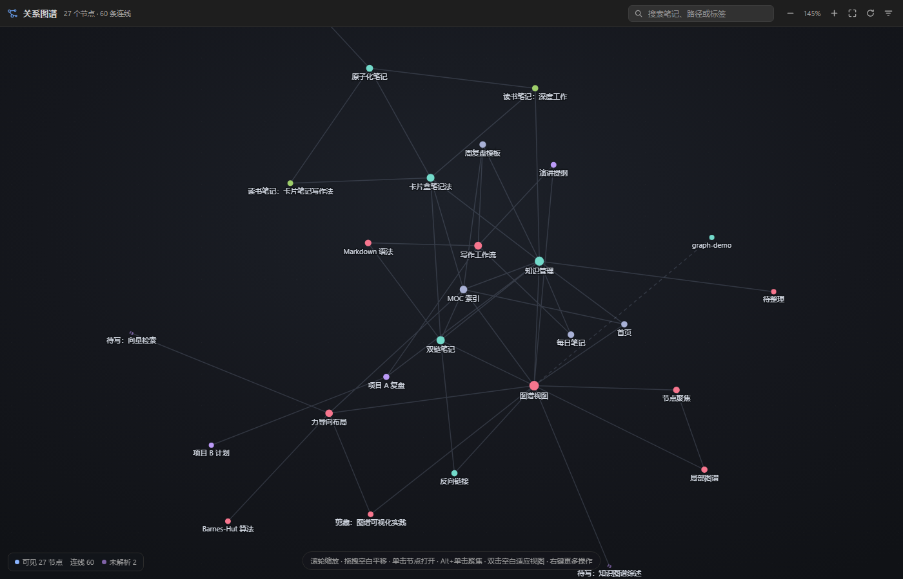
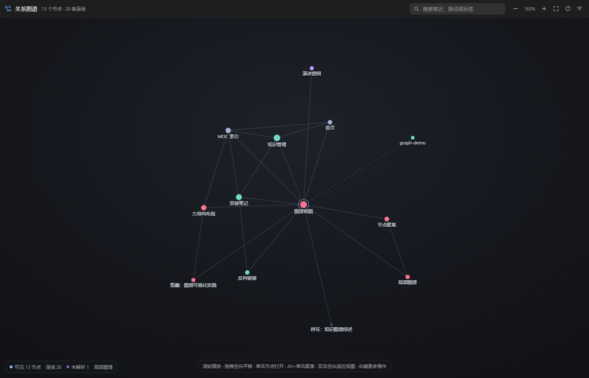
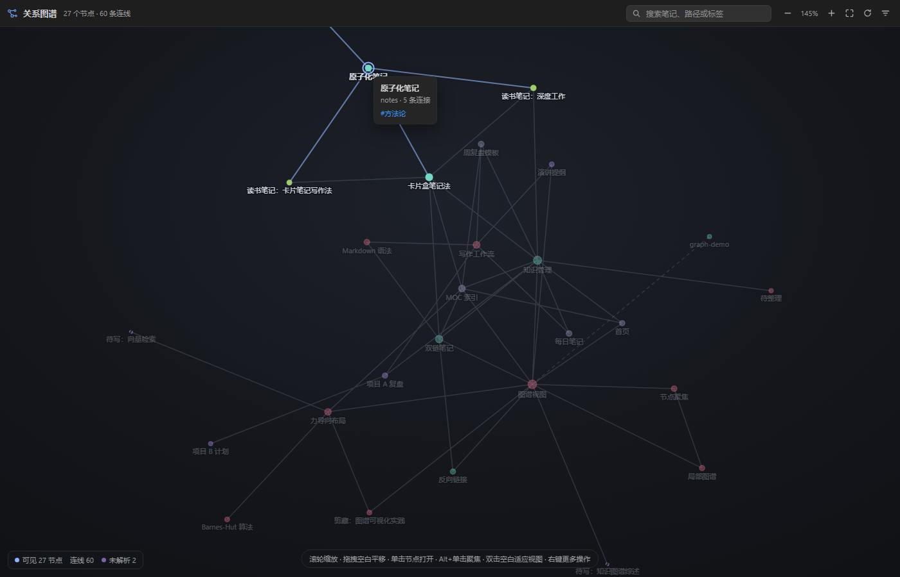
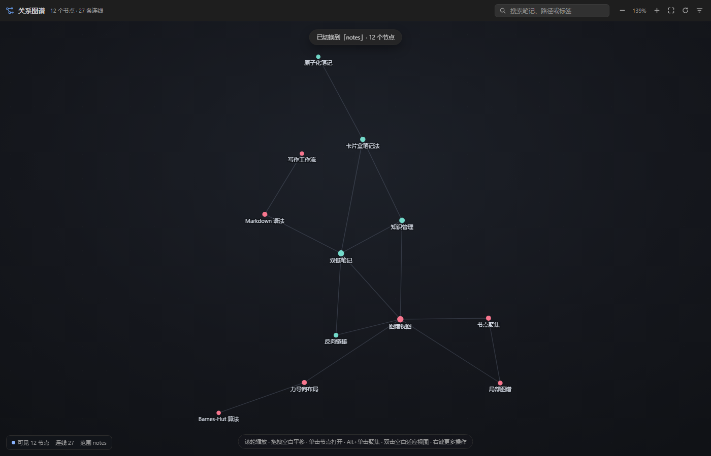
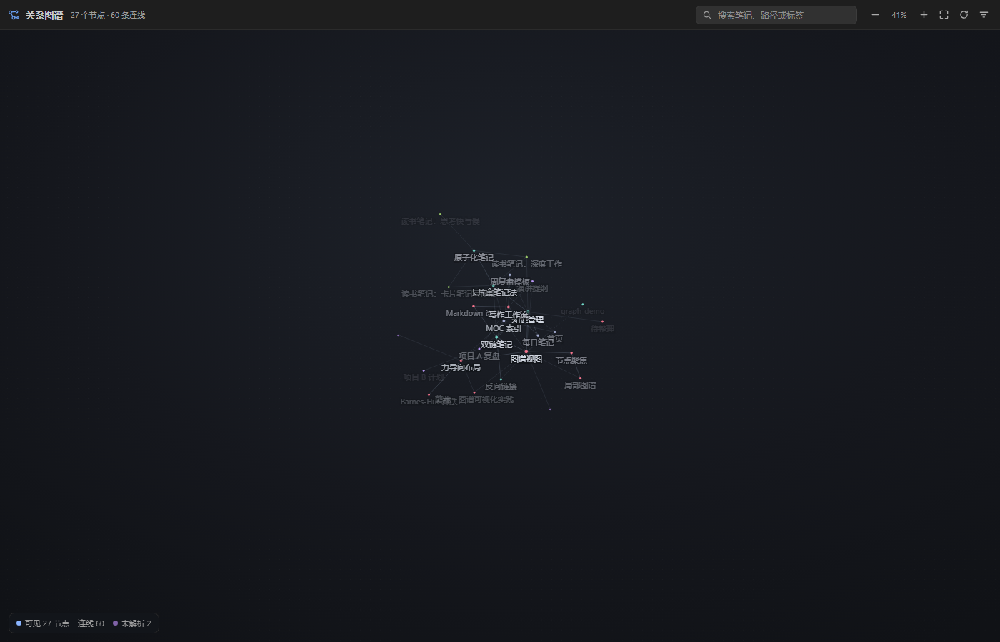
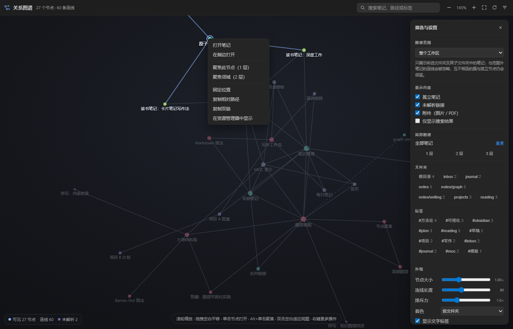
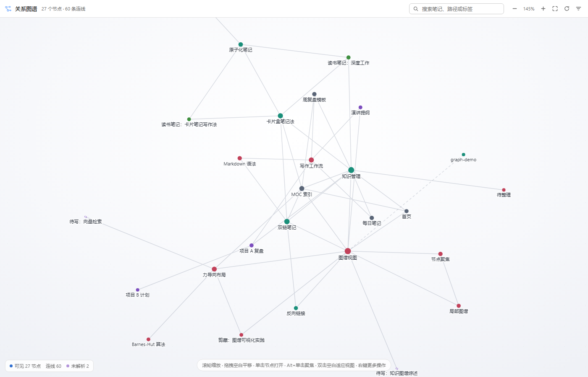
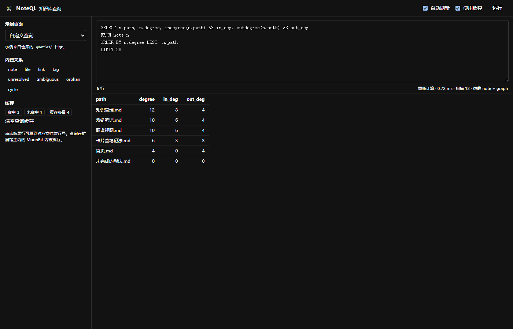

# 界面截图

## 深色主题 · 全局图谱

滚轮缩放、拖拽平移；节点按文件夹着色，虚线连接表示嵌入/附件，紫色虚线圆是未解析链接。

## 局部图谱 · 焦点节点 1 层邻域

焦点节点外围有蓝色虚线环，只保留邻域内的节点与连线。

## 悬停高亮（v1.1 修复）

悬停「原子化笔记」：相连的节点与标签保持明亮，未相连的节点、连线与**标签文字**一起变暗。

## 文件夹图谱（v1.3）

范围切到 `notes`：只显示该目录及其子目录的 12 篇笔记，范围外连线被忽略。

## 标签随缩放淡出（v1.3）

缩到 41% 时标签逐渐透明（大节点保留更久），继续缩小到 18% 时完全消失。

## 筛选面板与右键菜单

右侧为筛选/外观面板，左侧为节点右键菜单。

## 浅色主题

跟随 VS Code 主题自动切换配色。

## NoteQL 查询面板（v2.1）

左侧是示例查询、内置关系与缓存统计；右侧是查询编辑器与结果表。
点击结果行会跳到对应文件与行号。

> 这张图由 `node scripts/query-preview.js` 生成静态预览，
> 再用 `node scripts/shot.js` 无头截图；预览页使用 mock `vscode` API，
> 不需要启动 VS Code 即可检查布局与交互。
